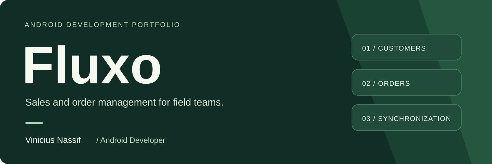

[English](README.md) · [Português](README.pt-BR.md)

# Fluxo · Android development portfolio

I’m **Vinicius Nassif**, an Android developer based in Brazil. I develop and maintain Fluxo, a business application used in field sales at **Líder Minas (Milani)**. My work includes implementing features, investigating operational issues, testing, preparing builds, and supporting users.

Fluxo connects the everyday work of sales representatives—finding a customer, selecting products, assembling an order—to the company’s processing systems. Local persistence lets users consult downloaded data and prepare orders without a continuous connection, within the application’s synchronization rules.

**Kotlin · Jetpack Compose · Material 3 · Room / SQLite · Coroutines · StateFlow · Retrofit · Firebase Cloud Messaging**

[Explore the screens](docs/screens.md) · [Engineering decisions](docs/engineering.md) · [About me](docs/about.md) · [Contact](mailto:viniciusbnassif@outlook.com)

## A look at the application

<table>
  <tr>
    <th>Product catalog</th>
    <th>Quantity and pricing</th>
    <th>Integration</th>
  </tr>
  <tr>
    <td></td>
    <td></td>
    <td></td>
  </tr>
</table>

These are actual Android device captures, not UI mockups. Customer identifiers and contact information are covered with opaque redactions. The application UI is in Portuguese; this portfolio is available in English and Portuguese.

## What Fluxo does

| Area | User workflow | Implementation focus |
| --- | --- | --- |
| Customers | Search and filter customers; consult registration, purchase history, and contact information; start a visit. | Local data access and contextual actions. |
| Product catalog | Browse products with photos, search, and jump directly to product groups. | Lazy grid, sticky section headers, and a custom group index. |
| Orders | Enter sale and exchange quantities, review prices and payment terms, save a draft, or finalize an order. | Validation, monetary calculations, and transactional local persistence. |
| Quantity suggestions | Reuse a customer’s recent minimum or maximum quantity for the selected product. | Asynchronous history lookup, loading feedback, and duplicate-free suggestions. |
| Integration | Send pending work and refresh the data appropriate to the selected user’s role. | Concurrent downloads, explicit task states, and recovery-oriented feedback. |
| Messages | Follow order processing, read details, and use swipe actions to archive or change read status. | User-scoped data, database observation, and FCM handling. |
| Reports | Review sales with period filters, charts, and list views. | Presenting operational data in forms suited to different questions. |
| Help | Learn workflows inside the app, including status indicators and interactive examples. | Reusing actual UI components in the guide. |

### Negotiation workflow — in preparation

Fluxo also contains a price-negotiation workflow for seller requests and supervisor decisions. It includes structured product details, approval/rejection controls, role-dependent status indicators, and a safeguard against deciding from an incomplete product list.

**The seller’s entry point is feature-gated in the reviewed version.** This is presented as work in preparation, not as a generally released feature. The gallery shows its in-app instructional examples, clearly labeled as demonstrations.

## Engineering beyond the screens

### Local persistence before transmission

An order and its items are persisted together in a Room transaction before transmission. Order-number selection compares the server-provided sequence with the selected user’s local orders; the number is checked again during saving. This addresses local consistency without assuming that a phone can guarantee server-wide uniqueness on its own.

### State that follows the database

Room flows and `StateFlow` connect persistent data to Compose. This matters when a message changes after it is opened, when the selected user’s information is refreshed, or when synchronization updates a list already on screen. Product-history requests also handle cancellation when the selection changes.

### Different users, different synchronization work

The selected user’s group determines the download branch: supervisors receive negotiation data; other users receive the commercial datasets. The design avoids treating “no customers downloaded” as evidence of a user’s role. Independent downloads can run concurrently, while the UI reports their individual outcomes.

### Interface details built around actual use

The product-group index navigates by category rather than by a percentage of the entire catalog. Message screens support a list–detail layout at wider sizes. Shared controls, glass effects, and interactive help examples are built with Compose and supporting libraries rather than separate static screen designs.

[Read the technical case study →](docs/engineering.md)

## Technology in context

| Layer | Technologies |
| --- | --- |
| Interface | Jetpack Compose, Material 3, adaptive layouts, custom controls |
| State and asynchronous work | ViewModel, Kotlin Coroutines, Flow / StateFlow |
| Device storage | Room, SQLite, DataStore |
| Remote communication | Retrofit, OkHttp, Gson, Firebase Cloud Messaging |
| Images and visual effects | Coil, Haze, shared Compose components |
| Verification and delivery | Focused unit/regression tests, functional testing, Gradle builds, signed Android releases |

## Project context

Fluxo is an operational business application with private distribution, including managed Android deployment. This repository is a **portfolio and technical case study**, not the Android source repository or an installation package.

The screenshots were captured on a physical Samsung Galaxy A07 in October 2026. No real order was submitted for the demonstration. Broader-layout behavior is described from the implementation; these captures do not pretend to be tablet tests.

## Let’s talk

I’m interested in Android development opportunities where I can work on useful applications, understand their business rules, and keep improving them after release.

**[LinkedIn](https://www.linkedin.com/in/viniciusbnassif) · [GitHub](https://github.com/viniciusbnassif) · [viniciusbnassif@outlook.com](mailto:viniciusbnassif@outlook.com)**

[Professional background and education →](docs/about.md)
