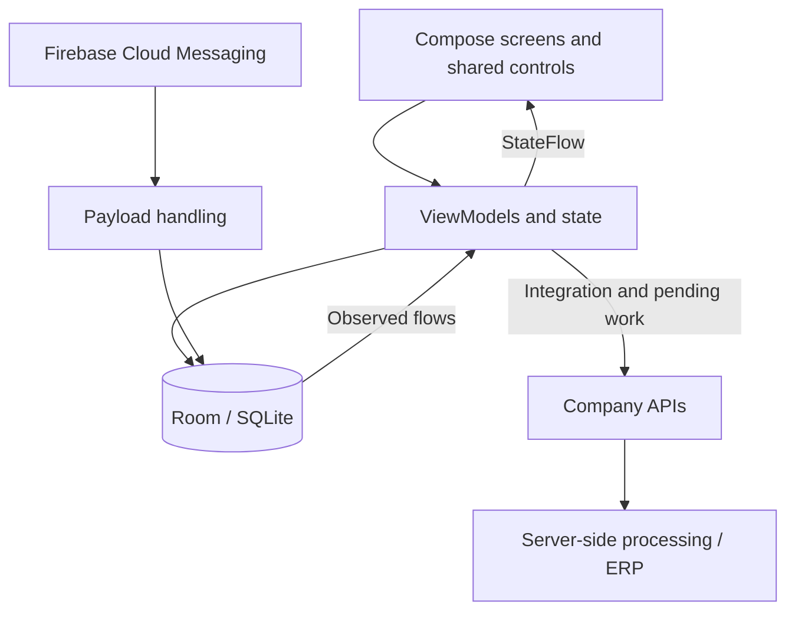

# Fluxo · Engineering case study

[Portfolio](../README.md) · [Português](engineering.pt-BR.md) · [Screen gallery](screens.md)

Fluxo’s technical work is shaped by a practical constraint: the user must be able to prepare an order on a phone, keep that work locally, and later reconcile it with the company’s systems. A successful network request, a saved local order, and a completed ERP process are different events.

## System overview

This is a simplified view of the implemented data flow, not a claim that every feature follows an identical abstraction hierarchy.

## 1. Keeping orders consistent

**Problem:** an interruption during saving must not leave a header without its items. Numbering must also account for orders already known by the server, even when the local device has a shorter history.

**Implementation:** order data and item changes are grouped in a Room transaction. The next local identifier considers the greater of the selected user’s server-provided sequence and local order sequence, then increments it. Saving checks the identifier again within the transaction. Transmission follows the local commit.

**Boundary:** this protects a local operation. The backend must still validate duplicates and concurrent activity across devices; local numbering is not a substitute for server-side constraints.

Money conversion uses integer cents and decimal handling at conversion boundaries. Focused tests exercise localized input, fractional quantities, discounts, and serialization rather than relying on formatted UI text as a source of truth.

## 2. Role-based integration

**Problem:** a supervisor and a sales representative need different datasets. Deciding that someone is a supervisor because a customer download returned zero records couples authorization to a network result.

**Implementation:** refresh and persist the selected user’s information, then use the stored group to choose the download path. Supervisors download negotiations; other users download the applicable commercial datasets without downloading negotiations. Independent tasks can start concurrently.

Each task reports its own progress. The overall integration must distinguish running, successful, warning, and failed outcomes; a list that looks finished is not by itself proof that all required work succeeded. First-run and conditional procedures also need to remain part of the completion logic.

**Trade-off:** local access remains governed by synchronization freshness and business rules. “Works with local data” does not mean unrestricted indefinite offline operation.

## 3. Reactive state and cancellable history lookup

**Problem:** holding a one-time copy of a message or user leaves the screen stale when the same database record changes. A slow product-history request can also return after the user has selected a different product.

**Implementation:** observe relevant Room queries and expose state through the ViewModel. The product-history path cancels the previous request, resets its result, exposes loading, and applies the result only to the active request. Cancellation is preserved rather than reported as an ordinary business error.

The quantity suggestion uses the customer, selected user, product, and recent history. Minimum and maximum values become one or two distinct nonzero suggestions; absent or zero-only results produce no suggestion section. The dialog can appear while that query is still running.

**Why it matters:** loading is an explicit state, not an assumption that a query will always finish before composition. A real-device capture of a fast lookup does not replace testing the delayed case.

## 4. A catalog indexed by category

**Problem:** ordinary proportional scrolling makes a small group hard to target when another group contains many more products.

**Implementation:** a custom side index maps each point to a product group and scrolls the grid to that group’s position. Sticky headers identify sections. The complete eligible product collection is loaded for the screen while lazy UI rendering composes items around the viewport.

**Trade-off:** loading the collection is not the same as rendering every card. It still has a memory cost proportional to the selected data; image loading and composable lifecycle are separate concerns. This portfolio does not claim measured memory or frame-rate improvements.

## 5. Messages are business state, not only notifications

FCM payload handling supports explicit message types and compatibility with legacy fields. Persisted messages are scoped to their recipient. The UI observes changes, distinguishes read and archived states, and communicates order outcomes separately from negotiation decisions.

For structured negotiations, product codes identify local catalog names and images. Prices are transported in cents; percentages use hundredths. An incomplete product payload must be synchronized before enabling approval or rejection.

There are two meanings of “done”:

| Recipient | Event | UI meaning |
| --- | --- | --- |
| Supervisor | Negotiation awaits a response | Attention: a decision is still required. |
| Supervisor | Approval or rejection was recorded | The supervisor’s decision is complete. |
| Seller | Negotiation was approved | The order can continue through processing. |
| Seller | Negotiation was rejected | Action required; rejection is not shown as success. |
| Seller | Order was received | Processing is not necessarily complete. |

The negotiation workflow is implemented in preparation for release; its seller entry is feature-gated in the version reviewed here.

## 6. UI reuse and adaptive presentation

The message interface includes a wider list–detail arrangement with adjustable pane proportions and reading-space limits. Compact screens preserve a focused list/detail experience. Shared controls and glass styling are implemented with Compose and supporting libraries, including Haze.

The help guide reuses actual components for selected examples, including a resettable response slider and status icons. This keeps those examples connected to the current theme and component behavior instead of making every explanation a screenshot that ages independently.

## Verification approach

The source includes focused tests for monetary conversion, negotiation payload handling, message formatting, selected-user observation, and integration scope. These tests complement functional checks; they are not a claim of complete coverage or a test run performed specifically for this portfolio.

For this presentation, actual device navigation and screenshot capture were performed without sending an order or triggering a synchronization. Customer data was redacted before publication. Backend endpoint details, credentials, databases, signing material, and app source are not included.

## What this project demonstrates

- Translating operational business rules into Android behavior.
- Connecting local persistence, asynchronous work, and reactive UI state.
- Handling financial data and order consistency beyond the visible form.
- Designing role-specific workflows without confusing completion with success.
- Maintaining an application after release, including troubleshooting and user guidance.

[See the screens](screens.md) · [About Vinicius](about.md) · [Back to portfolio](../README.md)
