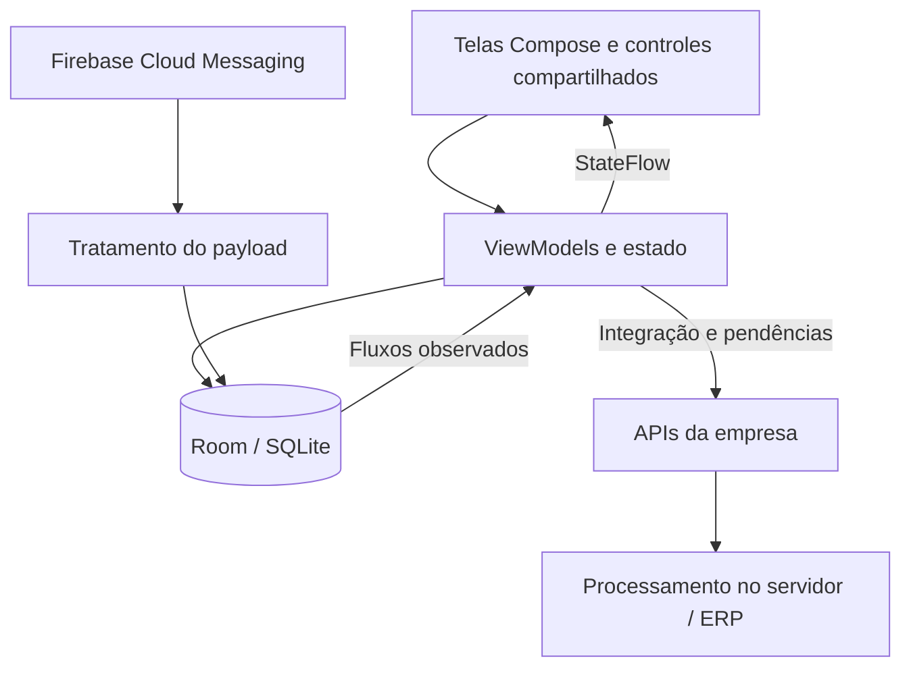

# Fluxo · Estudo de caso técnico

[Portfólio](../README.pt-BR.md) · [English](engineering.md) · [Galeria](screens.pt-BR.md)

O desenvolvimento do Fluxo parte de uma necessidade prática: o usuário deve conseguir montar um pedido no celular, preservar esse trabalho localmente e depois conciliá-lo com os sistemas da empresa. Uma requisição bem-sucedida, um pedido salvo no aparelho e um processamento concluído no ERP são eventos diferentes.

## Visão geral

Este é um resumo do fluxo de dados implementado, não uma afirmação de que todas as funcionalidades usam uma hierarquia idêntica de abstrações.

## 1. Consistência dos pedidos

**Problema:** uma interrupção durante a gravação não pode deixar apenas o cabeçalho, sem seus itens. A numeração também precisa considerar os pedidos já conhecidos pelo servidor, mesmo que o histórico local seja menor.

**Implementação:** pedido e alterações nos itens são agrupados em uma transação do Room. O próximo identificador considera o maior valor entre a sequência recebida do servidor e a sequência local do usuário selecionado, somando um. O identificador é conferido novamente dentro da transação de gravação. A transmissão acontece depois da persistência local.

**Limite:** isso protege a operação local. O backend ainda precisa validar duplicidades e concorrência entre dispositivos; numeração no celular não substitui as restrições do servidor.

A conversão monetária utiliza centavos inteiros e tratamento decimal nas fronteiras de conversão. Testes pontuais verificam entrada localizada, quantidades fracionadas, descontos e serialização, sem tratar o texto formatado da interface como fonte dos valores.

## 2. Integração conforme o grupo

**Problema:** supervisor e vendedor precisam de dados diferentes. Definir o papel de alguém porque um download de clientes retornou zero registros mistura uma regra de acesso com o resultado de uma chamada de rede.

**Implementação:** atualizar e persistir o cadastro do usuário selecionado e então usar o grupo salvo para escolher o caminho do download. Supervisores baixam negociações; os demais usuários baixam os conjuntos comerciais aplicáveis, sem baixar negociações. Tarefas independentes podem começar em paralelo.

Cada tarefa informa seu próprio andamento. A integração precisa distinguir execução, sucesso, alerta e falha; uma lista que parece ter terminado não comprova, sozinha, o sucesso de todos os processos necessários. Procedimentos condicionais e de primeira execução também precisam fazer parte dessa lógica.

**Escolha de projeto:** o uso dos dados locais continua sujeito às regras de negócio e à validade da integração. Funcionar com dados no aparelho não significa permitir operação offline por tempo indeterminado.

## 3. Estado reativo e consulta de histórico cancelável

**Problema:** manter uma cópia pontual da mensagem ou do usuário deixa a tela desatualizada quando o mesmo registro muda no banco. Uma consulta lenta de histórico também pode terminar depois de o usuário selecionar outro produto.

**Implementação:** observar as consultas pertinentes do Room e expor o estado pelo ViewModel. A consulta de histórico cancela a anterior, limpa o resultado, informa carregamento e aplica a resposta à solicitação ativa. O cancelamento é preservado, não convertido em um erro comum de negócio.

A sugestão de quantidade considera cliente, usuário selecionado, produto e histórico recente. Mínimo e máximo geram uma ou duas sugestões distintas e diferentes de zero. Ausência de resultados ou valores apenas zerados não cria a seção. O diálogo pode aparecer enquanto a consulta está em andamento.

**Importância:** carregamento é um estado explícito, não uma aposta de que a consulta sempre terminará antes da composição. Capturar uma consulta rápida no aparelho não substitui testar o caso demorado.

## 4. Catálogo com índice por categoria

**Problema:** uma barra proporcional comum torna um grupo pequeno difícil de alcançar quando outro grupo possui muitos produtos.

**Implementação:** o índice lateral associa cada ponto a um grupo e posiciona a grade na seção correspondente. Cabeçalhos fixos identificam as seções. A tela carrega a coleção completa de produtos elegíveis, enquanto a interface lazy compõe os itens no entorno da área visível.

**Escolha de projeto:** carregar os dados não significa renderizar todos os cartões. Ainda existe um custo de memória proporcional à coleção; carregamento das fotos e ciclo de vida dos composables são questões separadas. Este portfólio não apresenta ganhos de memória ou de taxa de quadros como se tivessem sido medidos.

## 5. Mensagens representam estados de negócio

O recebimento por FCM admite tipos explícitos de mensagem e compatibilidade com campos legados. As mensagens persistidas são vinculadas ao destinatário. A interface observa alterações, diferencia leitura de arquivamento e separa o resultado do pedido da decisão de negociação.

Nas negociações estruturadas, o código do produto permite reutilizar nome e foto do cadastro local. Preços trafegam em centavos; percentuais, em centésimos. Uma lista incompleta de produtos precisa ser sincronizada antes de liberar aprovação ou recusa.

“Concluído” possui significados diferentes:

| Destinatário | Evento | Significado na interface |
| --- | --- | --- |
| Supervisor | Negociação ainda sem resposta | Atenção: ainda falta decidir. |
| Supervisor | Aprovação ou recusa registrada | A participação do supervisor foi concluída. |
| Vendedor | Negociação aprovada | O pedido pode seguir no processamento. |
| Vendedor | Negociação recusada | É necessário agir; recusa não aparece como sucesso. |
| Vendedor | Pedido recebido | O processamento não está necessariamente concluído. |

O fluxo de negociação está implementado em preparação para lançamento; a entrada para o vendedor está desabilitada por flag na versão analisada.

## 6. Reutilização e layouts adaptativos

A interface de mensagens possui uma organização de lista e detalhe para larguras maiores, com proporções ajustáveis e limites de leitura para os painéis. Em telas compactas, mantém a experiência focada na lista ou no detalhe. Controles compartilhados e efeitos de vidro utilizam Compose e bibliotecas de apoio, incluindo Haze.

O manual reaproveita componentes reais em alguns exemplos, como o slider de resposta com reset e os ícones de estado. Assim, esses exemplos acompanham o tema e o comportamento atual do componente, sem depender exclusivamente de imagens que envelhecem separadamente.

## Abordagem de verificação

O código contém testes pontuais de conversão monetária, payloads de negociação, formatação de mensagens, observação do usuário selecionado e escopo da integração. Eles complementam a verificação funcional; não representam cobertura completa nem uma execução de testes feita especificamente para este portfólio.

Nesta apresentação, a navegação e as capturas foram realizadas em aparelho físico, sem enviar pedido ou iniciar integração. Dados dos clientes foram ocultados antes da publicação. Endereços internos de APIs, credenciais, bancos, chaves de assinatura e código-fonte do app não estão incluídos.

## O que este projeto demonstra

- Transformação de regras da operação em comportamento Android.
- Conexão entre persistência local, tarefas assíncronas e estado reativo da interface.
- Tratamento de valores e consistência dos pedidos além do formulário visível.
- Fluxos específicos por usuário, sem confundir término com sucesso.
- Manutenção após a entrega, incluindo investigação de problemas e orientação aos usuários.

[Conheça as telas](screens.pt-BR.md) · [Sobre Vinicius](about.pt-BR.md) · [Voltar ao portfólio](../README.pt-BR.md)
