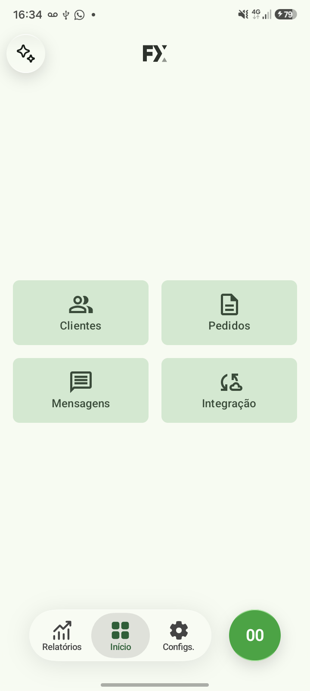
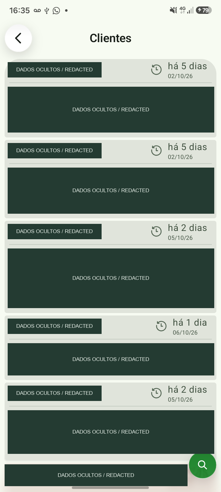
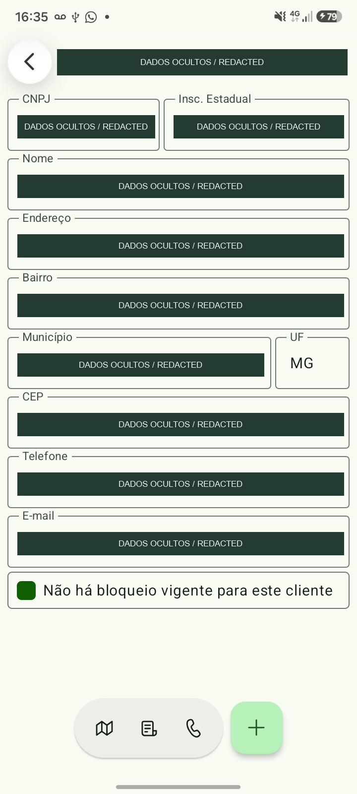
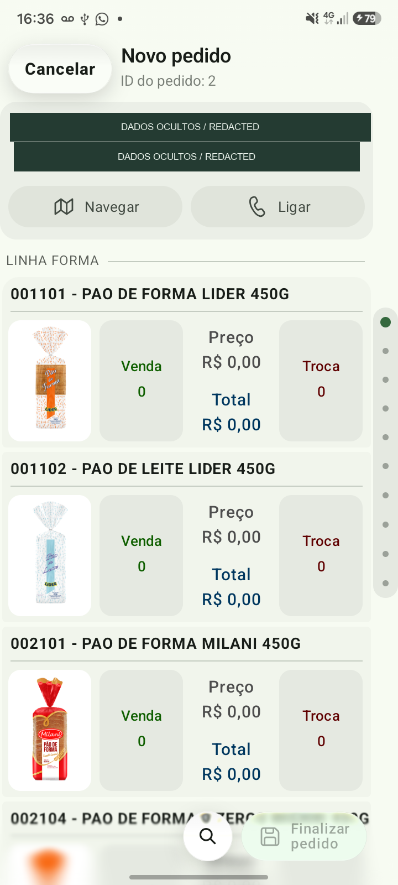
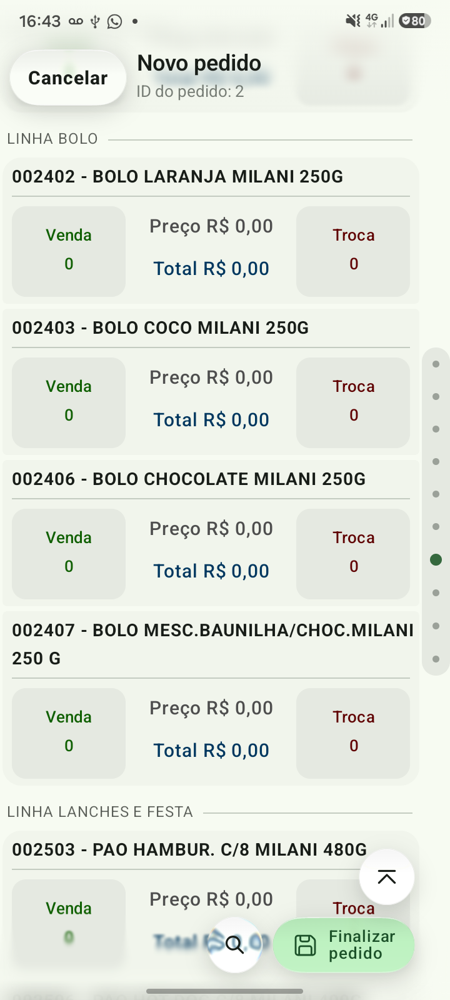
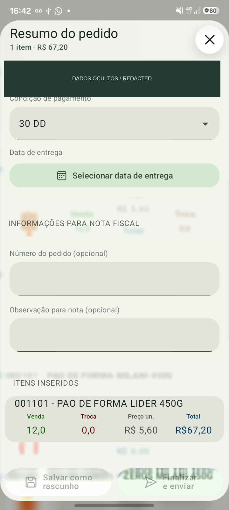
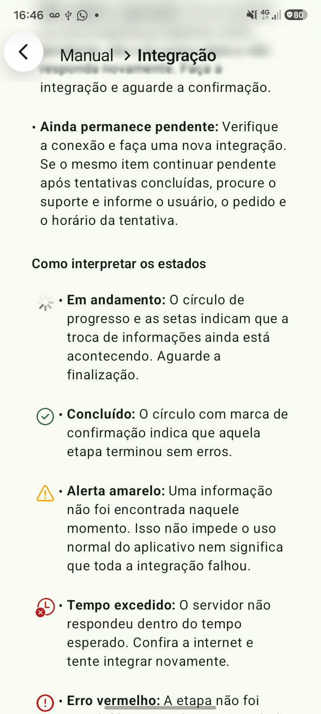
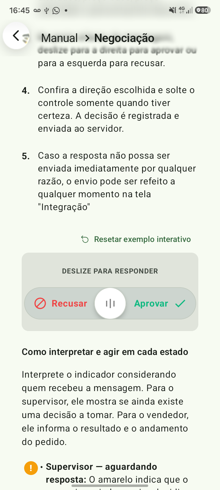
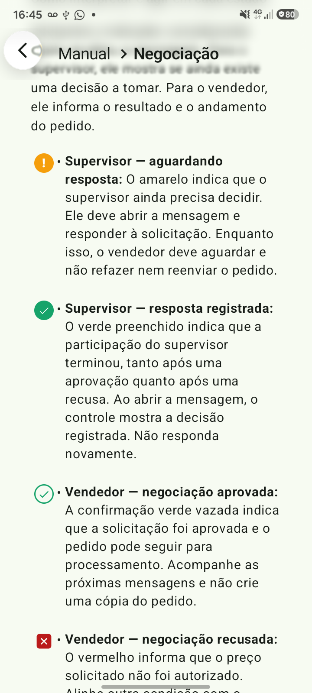

# Fluxo · Screen gallery

[Portfolio](../README.md) · [Português](screens.pt-BR.md) · [Engineering](engineering.md)

Twelve captures from a physical Android phone show the application’s interface and its in-app guide. Tap an image to view it at full resolution. Customer details are covered with opaque redactions, including information visible through glass surfaces.

## 1. Home and customer lookup

<table>
  <tr><th>Home</th><th>Customers</th></tr>
  <tr>
    <td></td>
    <td></td>
  </tr>
</table>

The home screen gives direct access to customers, orders, messages, and integration. Bottom navigation separates reports, the home area, and configuration.

Customer cards bring registration information and last-purchase recency into the same view. Search and filters support finding the customer before starting a visit. The dark rectangles in this capture are publication redactions, not application placeholders.

## 2. Customer context and product selection

<table>
  <tr><th>Customer details</th><th>Product catalog</th></tr>
  <tr>
    <td></td>
    <td></td>
  </tr>
</table>

The customer detail screen groups registration and contact fields, indicates blocking conditions, and offers navigation, calling, history, and visit actions.

During order entry, product rows combine code, name, image, sale quantity, exchange quantity, and totals. The customer context remains available at the top. Products retain their eligibility rules rather than simply exposing every record in the local database.

## 3. Category navigation and quantity entry

<table>
  <tr><th>Direct navigation by product group</th><th>Quantity dialog</th></tr>
  <tr>
    <td></td>
    <td></td>
  </tr>
</table>

The side index maps points to product groups. It lets the user jump to a category without dragging through every preceding product. Section headers identify the current group, while lazy rendering limits which item interfaces are composed around the viewport.

The quantity dialog gives immediate price and total feedback. When recent history exists for the customer and product, quantity suggestions are shown without repeating equal values or displaying zero-only results. This particular capture does not contain historical suggestions.

## 4. Order review and synchronization

<table>
  <tr><th>Order review</th><th>Integration</th></tr>
  <tr>
    <td></td>
    <td></td>
  </tr>
</table>

Order review brings together payment terms, delivery date, invoice information, and the selected items. The title and total remain separate from the scrolling details, as do the draft and finalization actions. A redaction also covers customer information visible behind the translucent dialog.

Integration exposes the last refresh and guides the user through exchanging data with the company’s server. Its download scope depends on the selected user’s group. **The sample order was discarded; neither order submission nor synchronization was executed to create these captures.**

## 5. In-app assistance

<table>
  <tr><th>Help topics</th><th>Integration status guide</th></tr>
  <tr>
    <td></td>
    <td></td>
  </tr>
</table>

Help is part of the application rather than a separate document. Topics explain the steps users need to take and how to react to different outcomes. Native icons and interactive controls can follow the current theme and component implementation instead of relying exclusively on static screenshots.

## 6. Negotiation examples · feature in preparation

<table>
  <tr><th>Interactive response example</th><th>Role-aware status indicators</th></tr>
  <tr>
    <td></td>
    <td></td>
  </tr>
</table>

These two screens are **instructional examples inside the manual**, not a live supervisor inbox. The slider demonstrates the decision gesture without submitting a negotiation.

The meaning of completion depends on the recipient. A supervisor who has answered is finished with the decision, whether it was approval or rejection. For the seller, rejection is an outcome that requires action and uses an error indicator. Pending supervisor decisions use an attention state.

The seller-facing negotiation entry remains feature-gated in the reviewed version. Its presence in the guide does not imply general release.

## Capabilities not represented by a live screenshot

- **Messages:** read/unread state, archive gestures, order progress, structured negotiation details, and list–detail presentation at wider sizes. The selected user’s inbox was empty during capture; no messages were fabricated.
- **Reports:** period filters, sales charts, and list presentation. Live commercial values were excluded from this public gallery.
- **Wider layouts:** documented from the implementation. The gallery contains phone captures, not a tablet validation session.

Screens captured in October 2026 on a Samsung Galaxy A07. UI appearance can change between application versions.

[Back to portfolio](../README.md) · [Read the technical case study](engineering.md)
